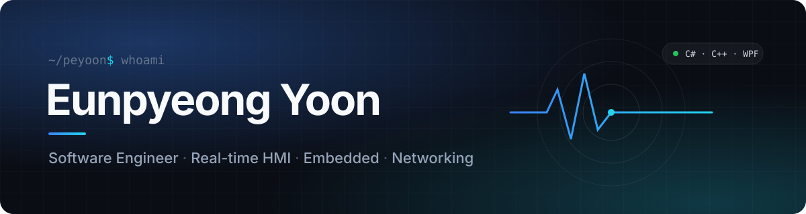

  
  

### About

실시간 데이터를 받아 **화면에 보여주고, 명령을 다시 내려보내는 HMI 소프트웨어**를 만듭니다.
패킷 한 줄, 보드 콘솔 한 줄처럼 소프트웨어와 하드웨어가 맞닿는 지점을 좋아하고, **국방 · 항공우주 SW**를 향해 가고 있습니다.

### Tech Stack

  
  
  
  
  
  
  
   
  
  
  
  
  
  
  

### Projects

**ADIS** · 방공 요격 시뮬레이션  
SIM이 UDP(10Hz)로 표적 데이터를 보내면 GCS가 전술 레이더 화면에 실시간으로 그리고, TCP로 요격 명령을 내려보냅니다. 12바이트 공통 헤더로 패킷을 설계하고 Heartbeat로 통신 상태를 감시합니다.  
`C# WPF` `C++ DLL` `P/Invoke` `UDP/TCP`

**Gamma Spectrum HMI** · 감마 스펙트럼 핵종 판별  
CNN 모델을 ONNX로 내보내 C#에서 추론하고, 실시간 스펙트럼 차트와 핵종별 확률을 보여줍니다. Python과 C#의 전처리 결과를 대조하는 검증 기능을 넣었습니다.  
`C# WPF` `ONNX Runtime` `PyTorch`

**Radar Simulator** · 레이더 시뮬레이터  
DMS ↔ Decimal, Degree ↔ Mil 좌표 변환, INI 기반 설정 저장, 여러 창 간 데이터 공유를 구현했습니다.  
`C# WPF`

**Club Management System** · 동호회 일정 관리  
회사 동호회 일정을 등록하고 조회 · 관리하는 데스크톱 앱입니다.  
`C# WPF`

  
  

### Experience

**올제텍** · 소프트웨어 엔지니어 인턴 약 7개월
- 실시간 데이터 분석 시스템(DAS)의 사후 분석 화면(주기 · 응답 · 교전반응 분석) 개발
- Wireshark와 CSV 대조로 패킷 무결성을 검증하고, Pcap 데이터의 포트 역전 문제를 추적해 해결
- 사용자가 설정한 개수만큼 생성되는 동적 게이지 패널 UI 개발

### Stats

  
  

  

